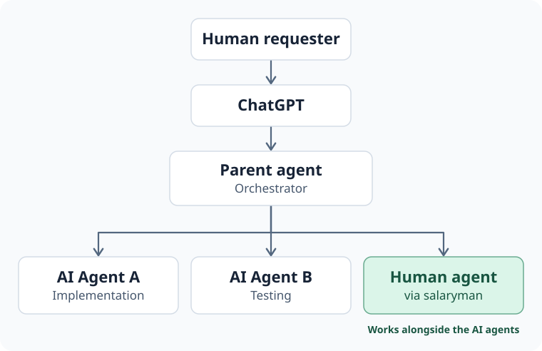
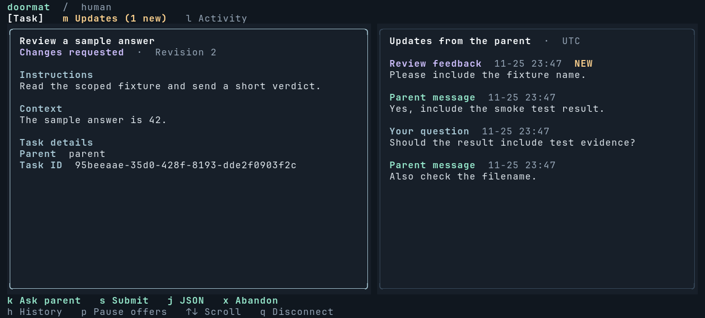

# salaryman

human as an agent

[English](README.md)

AI の親エージェントが作業範囲を指定し、受付を有効にした人間にタスクを依頼するためのローカルランタイムです。Linux ホストに SSH で接続して `salaryman attach` を実行します。タスクを受け取ったら別のシェルや tmux セッションで作業し、必要に応じて親に質問して、レビュー用に成果を提出します。





## Linux でのインストールと起動

Bun、Git、util-linux の `flock` が必要です。作業用の tmux は任意です。デモと動作確認スクリプトは Bash、jq、tmux を使います。バージョンを固定した Nix 開発シェルに必要なツールが含まれています。

```sh
nix develop
bun install --frozen-lockfile
bun run typecheck
bun test
bun run build
./scripts/demo.sh
./scripts/tui-smoke.sh
```

各コマンドはチェックアウトしたディレクトリから実行できます。`salaryman` コマンドとして使う場合はシンボリックリンクを作り、`$HOME/.local/bin` を `PATH` に追加します。

```sh
mkdir -p "$HOME/.local/bin"
ln -s "$PWD/src/cli.ts" "$HOME/.local/bin/salaryman"
```

一方のシェルで `salaryman daemon`、もう一方で `salaryman attach --worker alice` を実行します。リンクを作らなかった場合は、`salaryman` の代わりに `bun --no-env-file src/cli.ts` を使えます。ビルドで生成される `dist/cli.js` は、インストール済みの依存パッケージとともに Bun で実行します。

ユーザー用ランタイムディレクトリがない Linux 環境では、自分だけがアクセスできるディレクトリを作り、絶対パスを `XDG_RUNTIME_DIR` として設定してください。デーモン、SSH シェル、MCP ホストでは同じ XDG 設定を使います。既定のランタイムディレクトリは `/run/user/$(id -u)`、状態の保存先は `$HOME/.local/state` です。

改名前のキュー、worktree、認証情報を引き続き使えるように、XDG 配下の `human-agent` ディレクトリと旧環境変数 `DOORMAT_*`、`HUMAN_AGENT_*` に対応しています。

## タスクを試す

TUI で `p` を押すか、起動時に `--available` を付けて受付を開始します。同じホスト上の親エージェント側のシェルでトークンを作成し、タスクを送ります。トークンは後から同じタスクを操作する際にも使うため、保存しておきます。

```sh
mkdir -p "$HOME/.config/salaryman"
export SALARYMAN_PARENT_TOKEN_FILE="$HOME/.config/salaryman/parent.token"
(umask 077; set -C; bun -e 'import {randomBytes} from "node:crypto"; console.log(randomBytes(32).toString("base64url"))' > "$SALARYMAN_PARENT_TOKEN_FILE")
salaryman parent delegate_to_human - <<'JSON'
{"requestId":"demo-1","parentId":"demo-parent","title":"サンプル値を確認する","instructions":"背景情報を読み、サンプル値を報告してください。","context":"サンプル値は 42 です。","allowedTools":["shell"]}
JSON
```

`a` で受諾します。親に質問するには `k` で入力欄を開き、`F2` で送信します。**Task** には最初の指示が表示されます。**Updates** では親からの連絡、自分の質問、レビューのフィードバックを新しい順に読めます。親からの更新が届くとタブに新着件数が表示され、`m` で最新の更新を開けます。`l` でタスクと worktree の操作履歴、`Esc` でタスクの指示に戻ります。

成果を提出するときは `s` で要約を入力するか、`j` で根拠、Git ref、diff、構造化された出力を JSON で入力します。どちらも `F2` で送信します。`h` で自分のタスク履歴を表示し、`q` で切断します。幅100列、高さ24行以上では指示と更新が並び、狭い端末では同じキーで画面を切り替えます。

CLI だけでも同じ手順を実行できます。`connect` は受付を有効にせずセッションを開き、`online` は60秒間タスクを受け付けます。`heartbeat` または `status` でその期限を延長できます。担当者側の各コマンドに `--worker alice` を付けます。全コマンドは `salaryman --help` で確認できます。提出ファイルの例です。

```json
{"submissionId":"demo-first","revision":1,"summary":"サンプル値を確認しました","evidence":["サンプル値は 42 です。"],"output":{"value":42}}
```

```sh
salaryman submit result.json --worker alice
```

親は `salaryman parent TOOL [FILE|-]` から各 MCP ツールを呼び出せます。結果を読むには `get_human_result` に `{"taskId":"…"}` を渡します。承認するときは `complete_human_task` にタスク ID と結果に含まれる提出 ID を渡します。自動デモでは一時的な Git リポジトリを使って、質問と返信、差し戻し、再提出、承認まで試せます。TUI の動作確認スクリプトは独立した tmux サーバーで実際の画面を操作します。

## Git worktree

デーモンの環境変数 `SALARYMAN_REPOSITORIES` に、利用を許可する別名と絶対パスの対応を JSON で設定します。たとえば `{"demo":"/home/alice/src/demo"}` です。タスクには `"workspace":{"repository":"demo","ref":"<commit-sha>"}` を含めます。ローカルブランチ名やタグも指定できます。タスクの作成から受諾までの間に基点を固定したい場合は、完全なコミットハッシュを使います。

タスクを受諾すると、担当が確定し、チェックアウト前に Git の基点が固定されます。デーモンは `$XDG_STATE_HOME/human-agent/worktrees/<task-id>` に detached worktree を作り、正確なパスを表示します。別の SSH シェルでそのパスを開くか、TUI で `w` を押してバックグラウンドの tmux セッションを作ります。CLI では `salaryman workspace --worker alice --tmux` を使います。準備が中断すると、タスクは `ACCEPTED` の状態で残ります。`w` で再試行できます。確保したパスに未コミットの変更がある場合、移動されている場合、シンボリックリンクになっている場合などは、手動で確認してください。タスクを取り消してもデーモンは worktree とその Git 登録を保持します。

Git で成果を提出するには、タスク用 worktree でコミットし、完全なコミットハッシュを `gitRef` に含めるか、小さな diff を提出します。デーモンは提出された根拠をそのまま保存します。Git ref の解決と確認はレビュアーが行います。worktree と元のチェックアウトは、Git のメタデータと ref を共有します。運用者が管理するリポジトリと Git 設定を使ってください。デーモンによる準備時には、フック、fsmonitor、ユーザー全体とシステム全体の Git 設定、プロトコルへのアクセス、外部フィルターを無効にします。submodule の初期化と partial clone の追加取得はランタイムの対象外です。

## NixOS のユーザーサービス

[examples/salaryman.service](examples/salaryman.service) を `~/.config/systemd/user/salaryman.service` にコピーし、Bun の実行ファイルとチェックアウトのパスを環境に合わせます。worktree を使う場合は [examples/daemon.env](examples/daemon.env) を `~/.config/salaryman/` にコピーして編集します。ユニットの `PATH` から `git` と `flock` を実行できるようにしてください。

```sh
systemctl --user daemon-reload
systemctl --user enable --now salaryman.service
journalctl --user -u salaryman.service
```

ユニットはユーザーマネージャーのランタイムディレクトリを使います。ログアウト後も稼働するかは、そのホストのユーザーマネージャーの設定によります。デーモンはフォアグラウンドでも起動できます。サービス例は T3 や Paseo の設定に依存しません。

## MCP ホスト

ブリッジの起動コマンドは `/absolute/path/to/bun --no-env-file /absolute/path/to/salaryman/src/cli.ts mcp` です。ホストとは MCP の標準入出力で通信し、デーモンには既存の Unix ソケットを使って接続します。MCP ホストはデーモンと同じマシン、同じ Unix アカウントでブリッジを起動してください。親トークンファイルは絶対パスで指定し、ランタイムディレクトリを変更した場合は `XDG_RUNTIME_DIR` もブリッジに渡します。`SALARYMAN_PARENT_TOKEN` を設定すると、トークンファイルより優先されます。親トークンは対応する親のタスクを操作できるため、非公開にしてください。

ブリッジは公式 MCP TypeScript SDK のクライアントで動作確認済みです。以下の Codex と Claude Code の登録構文は、ローカル CLI のヘルプと公式ドキュメントで確認しました。実際の登録と各ホストでの通し操作は、利用環境で確認してください。

**Codex** の `config.toml` またはプロジェクトの `.codex/config.toml` に追加します。[Codex の MCP ドキュメント](https://developers.openai.com/codex/mcp)

```toml
[mcp_servers.salaryman]
command = "/home/alice/.nix-profile/bin/bun"
args = ["--no-env-file", "/home/alice/src/salaryman/src/cli.ts", "mcp"]
env = { SALARYMAN_PARENT_TOKEN_FILE = "/home/alice/.config/salaryman/parent.token" }
env_vars = ["XDG_RUNTIME_DIR"]
```

**Claude Code** のプロジェクトにある `.mcp.json` に追加します。`XDG_RUNTIME_DIR` を変更しており、ホストから継承されない場合は、`env` にその絶対パスを指定します。[Claude Code の MCP ドキュメント](https://code.claude.com/docs/en/mcp)

```json
{
  "mcpServers": {
    "salaryman": {
      "type": "stdio",
      "command": "/home/alice/.nix-profile/bin/bun",
      "args": ["--no-env-file", "/home/alice/src/salaryman/src/cli.ts", "mcp"],
      "env": {"SALARYMAN_PARENT_TOKEN_FILE": "/home/alice/.config/salaryman/parent.token"}
    }
  }
}
```

**T3 Code** で使う場合は、実際に使用する Codex プロバイダーの設定ディレクトリか、Claude プロバイダーのプロジェクト設定に上記の内容を追加します。起動したスレッドに `salaryman` のツールが表示されることを確認してください。プロバイダーの起動時の上書き設定やインスタンスごとの設定ディレクトリによって手順が変わります。この環境での正確な設定パスと読み込みは未確認です。T3 自身のオーケストレーション用 MCP エンドポイントは、T3 のスレッドやサブエージェントを操作します。[T3 のプロバイダードキュメント](https://github.com/pingdotgg/t3code/blob/main/docs/internals/providers.md) · [Codex の設定上書きに関する issue](https://github.com/pingdotgg/t3code/issues/15828)

**Paseo** のセッション設定にある `mcpServers` も、上記と同じ JSON 形式です。既存の信頼済みプラグインから `agent.open.before` で追加するか、`agent.create.before` で永続化できます。インストール済みのバージョンでフックやプロバイダーが対応しているかは未確認です。ローカルの `paseo agent run --help` には MCP 登録用フラグがありません。[Paseo の stdio 設定型](https://github.com/getpaseo/paseo/blob/main/packages/protocol/src/agent-types.ts) · [Paseo のフックドキュメント](https://upd.dev/getpaseo/paseo/src/branch/main/public-docs/plugins/hooks.md)

## 親エージェントの操作

[human-delegate スキル](skills/human-delegate/SKILL.md) を親へのプロンプトとして渡すか、ホストのスキルディレクトリにインストールします。標準では人間に明示的に委任します。自動またはランダムで振り分けるには、呼び出し元による有効化、振り分け対象のタスク、受付中の担当者が必要です。振り分けの判定には次のコマンドを使えます。

```sh
salaryman route - <<'JSON'
{"mode":"random","eligible":true,"available":true,"attemptId":"review-42","rate":0.25}
JSON
```

親エージェントが振り分けを判断し、予定しているサブタスクのうち一つを salaryman に任せます。AI のサブエージェントも並行して作業できます。同じ試行 ID ならランダムモードでも同じ判定になります。`list_available_humans` が返す受付状況は目安です。デーモンはトランザクション内でタスクを割り当てます。

| ツール | 主な引数と動作 |
| --- | --- |
| `delegate_to_human` | 必須は `requestId`、`parentId`、`title`、`instructions`。オプションは `context`、`parentTaskId`、`workspace`、ISO 形式の `deadline`、`timeBudgetMinutes`、`allowedTools`、`expectedOutputSchema`。すぐに `taskId` を返します。同じリクエスト ID と入力で再試行すると、同じタスク ID が返ります。 |
| `list_available_humans` | 空のオブジェクトを渡します。受付を有効にしていて、担当中のタスクがない人を一覧表示します。 |
| `get_human_status` | `taskId`。タスクの状態と担当者の受付状況を返します。 |
| `message_human` | `taskId`、`text`。質問への回答待ちのタスクに返信すると、作業中に戻ります。 |
| `get_task_events` | `taskId`。任意のカーソル `after` と最大30件の `limit` を指定できます。`events`、`nextCursor`、`hasMore` を返します。 |
| `get_human_result` | `taskId`。過去の版は `submissionId` を指定して取得できます。 |
| `review_human_task` | `taskId`、現在の `submissionId`。レビューを開始します。 |
| `reopen_human_task` | `taskId`、現在の `submissionId`、`feedback`。版番号を進め、同じ担当者に差し戻します。 |
| `complete_human_task` | `taskId`、現在の `submissionId`、任意の `feedback`。承認して完了します。 |
| `cancel_human_task` | `taskId`、`reason`、`unacceptedOnly`。既定では受諾前のタスクのみ取り消せます。 |

作業の区切りでイベントの差分を取得するか、待つ場合は呼び出し元でポーリング間隔を伸ばしてください。通信が途切れて結果が分からない場合は、同じリクエスト ID で再確認します。代替担当への切り替えを許可している場合は、受諾前の取り消しか辞退を確認してから切り替えます。まだ誰にも委任していない場合は、そのまま代替担当に振れます。受諾と取り消しが競合した場合、先に受諾が確定すると受諾前限定の取り消しは失敗します。受諾後の明示的な取り消しで、そのタスクへのランタイム上の変更は止まります。人間のシェルは動き続けます。MCP ブリッジは通常のツール呼び出しを使います。予約実行、ターンの自動再開、MCP Tasks との連携はこの MVP の対象外です。

## アーキテクチャと動作上の制約

- `model.ts` と `service.ts` が状態遷移、割り当て、セッションの有効期限、タスクの所有権を管理します。サービスはリポジトリ、worktree 操作のインターフェース、時刻の取得関数を受け取ります。`sqlite.ts` は即時トランザクションを使い、同時に保持できるタスクを担当者一人につき一つに制限し、型付きイベントと提出物を永続化します。
- `daemon.ts` がランタイムを管理します。`ipc.ts` は Unix ソケット接続ごとに、サイズ制限とバージョンを持つ JSON リクエストを一つ処理します。ソケットは `0700` のランタイムディレクトリ内に作られ、権限は `0600` です。CLI、OpenTUI、SDK の stdio ブリッジは、同じ RPC の入力検証を使います。状態、SQLite の WAL、認証情報、worktree はプライベートな状態ディレクトリに保存します。
- オファーは2分後、または受諾前の締切に達した時点で失効します。切断や受付の一時停止で未受諾のオファーは取り下げられ、キューに戻ります。有効なセッションがなくなると担当者はオフラインになります。再起動でセッションは失効しますが、同じ担当者の認証情報で再接続すれば受諾済みのタスクを再開できます。レビュー中も担当枠はそのタスクが完了するまで使用中です。
- 主なセキュリティ境界は Unix アカウントです。その内部では、親トークンと担当者の認証情報によって RPC のアクセス範囲を決めます。同じ UID のプロセスや root は、ローカルファイルを読み書きし、別の担当者を装ったり、ランタイムに干渉したりできます。TUI に表示するのは範囲を限定したタスクの内容と、その担当者自身の割り当て履歴です。互いに信頼できない利用者間で使う場合は、OS アカウントを分けるなど、より強い隔離が必要です。
- MCP ブリッジから呼び出せるのはタスク操作で、任意のコマンド実行は受け付けません。worktree は元の作業ディレクトリから編集先を分け、Git メタデータを共有します。担当者のシェル、ファイルアクセス、ネットワーク、ツールやトークンの使用量は制限しません。許可ツール、作業時間の目安、受諾後の締切は参考情報です。出力の検証は、参照、パターン、フォーマット、`uniqueItems` を除いた JSON Schema draft-07 の自己完結した一部に対応しています。
- TUI の下書きと既読位置はセッション中のみ保持します。選択したタスクについて、各画面に最大80件のイベントを表示します。永続化された履歴は CLI のイベントカーソルでページ送りできます。ディスク障害時に担当者の認証情報を復旧する必要がある場合は、認証情報ファイルとデータベースを一緒にバックアップしてください。保存期間と削除は運用者が管理します。
