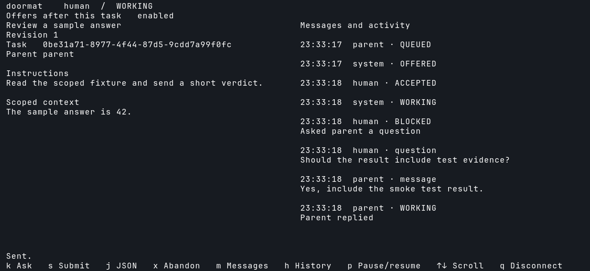

# doormat

human as an agent

A local runtime for handing scoped work from an AI parent to an opted-in human. SSH into the Linux host and run `doormat attach`. Accept an assignment, work from another shell or tmux session, ask the parent questions, and submit for review.



## Install and run on Linux

Requires Bun, Git, and `flock` from util-linux. tmux is optional for work sessions. The scripts use Bash, jq, and tmux. The pinned Nix dev shell provides the tools.

```sh
nix develop
bun install --frozen-lockfile
bun run typecheck
bun test
bun run build
./scripts/demo.sh
./scripts/tui-smoke.sh
```

All commands can run from the checkout. For a user-local `doormat` command, create a symlink and put `$HOME/.local/bin` on `PATH`.

```sh
mkdir -p "$HOME/.local/bin"
ln -s "$PWD/src/cli.ts" "$HOME/.local/bin/doormat"
```

Run `doormat daemon` in one shell and `doormat attach --worker alice` in another. Use `bun --no-env-file src/cli.ts` in place of `doormat` if you skipped the symlink. The build emits `dist/cli.js` for Bun and uses the installed dependencies.

On Linux without a user runtime directory, create an owned private directory and export its absolute path as `XDG_RUNTIME_DIR` in every participating process. Use the same XDG settings for the daemon, SSH shell, and MCP host. The default runtime base is `/run/user/$(id -u)` and the default state base is `$HOME/.local/state`.

The runtime retains the `human-agent` XDG subdirectories and accepts legacy `HUMAN_AGENT_*` environment variables so existing queues, worktrees, and credentials remain accessible after the rename.

## Try a task

Press `p` in the TUI to opt in, or launch with `--available`. In a parent shell on the same host, create a stable token and submit an assignment.

```sh
mkdir -p "$HOME/.config/doormat"
export DOORMAT_PARENT_TOKEN_FILE="$HOME/.config/doormat/parent.token"
(umask 077; set -C; bun -e 'import {randomBytes} from "node:crypto"; console.log(randomBytes(32).toString("base64url"))' > "$DOORMAT_PARENT_TOKEN_FILE")
doormat parent delegate_to_human - <<'JSON'
{"requestId":"demo-1","parentId":"demo-parent","title":"Verify the sample","instructions":"Read the scoped context and report the sample value.","context":"The sample value is 42.","allowedTools":["shell"]}
JSON
```

Press `a` to accept, `k` to ask a question, and `F2` to send. Use `m` to view messages, `s` to submit a summary, or `j` to submit JSON fields for evidence, a Git ref, a diff, or structured output. Both submission forms use `F2`. Press `h` for your assignment history and `q` to disconnect. At 100 columns and 24 rows the TUI shows task and activity side by side. At 60 columns it uses a single scrollable view with `m` switching between panes.

The headless CLI supports the same workflow. `connect` opens a headless session without opting into new offers. `online` opts in for a 60-second lease. `heartbeat` or `status` renews it. Pass `--worker alice` to each worker command. Run `doormat --help` for the command list. Example submission file contents follow.

```json
{"submissionId":"demo-first","revision":1,"summary":"Sample verified","evidence":["The fixture reports 42."],"output":{"value":42}}
```

```sh
doormat submit result.json --worker alice
```

The parent can call any MCP tool through `doormat parent TOOL [FILE|-]`. Read a result by sending `{"taskId":"…"}` to `get_human_result`. To approve it, pass the task ID and returned submission ID to `complete_human_task`. The automated demo creates an isolated fixture repo, exchanges a question and answer, and completes after one round of rework. The PTY smoke script drives the real TUI in an isolated tmux server.

## Git workspaces

Set `DOORMAT_REPOSITORIES` in the daemon environment to a JSON map of approved aliases to absolute paths, such as `{"demo":"/home/alice/src/demo"}`. Include `"workspace":{"repository":"demo","ref":"<commit-sha>"}` in the task. A plain local branch or tag also works. Use a full hash when the base must remain stable from creation through acceptance.

Explicit acceptance reserves the assignment and pins the Git base before checkout. The daemon creates a detached worktree under `$XDG_STATE_HOME/human-agent/worktrees/<task-id>` and displays its exact path. Open the path in another SSH shell or use `w` in the TUI to create a detached tmux session. The headless equivalent is `doormat workspace --worker alice --tmux`. An interrupted setup stays `ACCEPTED`. Press `w` to retry. If the reserved path is dirty, moved, a symlink, or otherwise ambiguous, inspect it manually. The daemon preserves worktrees and their registration, including after cancellation.

For a Git submission, commit in the task checkout and send the full commit hash in `gitRef`, or send a small diff. The daemon stores submitted evidence as provided. Reviewers resolve and inspect Git refs themselves. Worktrees share repository metadata and refs with the source checkout. Use repositories and Git configurations controlled by the operator. Managed setup disables hooks, fsmonitor, global and system Git config, protocol access, and external filters. Submodule initialization and partial clone fetching are outside the runtime workflow.

## NixOS user service

Copy [examples/doormat.service](examples/doormat.service) into `~/.config/systemd/user/doormat.service`, replacing the Bun binary and checkout paths. If using worktrees, copy and edit [examples/daemon.env](examples/daemon.env) under `~/.config/doormat/`. Ensure `git` and `flock` are on the unit's `PATH`.

```sh
systemctl --user daemon-reload
systemctl --user enable --now doormat.service
journalctl --user -u doormat.service
```

The unit uses the user manager's runtime directory. Survival across logout depends on the existing user-manager lifecycle on the host. The foreground daemon is also supported. The service examples have no dependency on T3 or Paseo configuration.

## MCP hosts

The bridge command is `/absolute/path/to/bun --no-env-file /absolute/path/to/doormat/src/cli.ts mcp`. It uses MCP stdio over the host's process pipes and connects to the existing Unix socket. The host must launch it on the daemon machine under the same Unix account. Use an absolute parent token file path and forward `XDG_RUNTIME_DIR` for custom locations. The `DOORMAT_PARENT_TOKEN` environment variable is also supported and takes precedence. Keep each parent's stable token private because it owns that parent's tasks.

The bridge was exercised with the official MCP TypeScript SDK client. The following Codex and Claude Code registration syntax was checked against local CLI help and upstream docs. Registration and full host sessions were left to the operator.

**Codex** `config.toml` or project `.codex/config.toml` entry. [Codex MCP docs](https://developers.openai.com/codex/mcp)

```toml
[mcp_servers.doormat]
command = "/home/alice/.nix-profile/bin/bun"
args = ["--no-env-file", "/home/alice/src/doormat/src/cli.ts", "mcp"]
env = { DOORMAT_PARENT_TOKEN_FILE = "/home/alice/.config/doormat/parent.token" }
env_vars = ["XDG_RUNTIME_DIR"]
```

**Claude Code** project `.mcp.json` entry. Use an absolute path for `XDG_RUNTIME_DIR` in `env` if it is customized and the host does not forward it. [Claude Code MCP docs](https://code.claude.com/docs/en/mcp)

```json
{
  "mcpServers": {
    "doormat": {
      "type": "stdio",
      "command": "/home/alice/.nix-profile/bin/bun",
      "args": ["--no-env-file", "/home/alice/src/doormat/src/cli.ts", "mcp"],
      "env": {"DOORMAT_PARENT_TOKEN_FILE": "/home/alice/.config/doormat/parent.token"}
    }
  }
}
```

**T3 Code.** Use the Codex provider's actual configuration home or the Claude provider's project configuration as above. Check that the resulting thread lists `doormat` tools. Provider launch overrides and instance-specific config homes vary. The exact configuration path and live injection on this installation are unverified. T3's own orchestration MCP endpoint serves a different purpose. [T3 provider docs](https://github.com/pingdotgg/t3code/blob/main/docs/internals/providers.md) · [Codex override issue](https://github.com/pingdotgg/t3code/issues/15828)

**Paseo.** The JSON above is also the documented shape of a Paseo agent's `mcpServers` map inside a session configuration. An existing trusted plugin can supply the entry from `agent.open.before`, or persist it via `agent.create.before`. Hook availability and provider support in the installed build are unverified. The local `paseo agent run --help` has no MCP registration flag. [Paseo stdio type](https://github.com/getpaseo/paseo/blob/main/packages/protocol/src/agent-types.ts) · [Paseo hook docs](https://upd.dev/getpaseo/paseo/src/branch/main/public-docs/plugins/hooks.md)

## Parent agent workflow

Use [the human-delegate skill](skills/human-delegate/SKILL.md) as the parent prompt or install it into your chosen host's skill directory. Explicit delegation is the default. Automatic and random routing require an opt-in caller policy, eligible work, and an available worker. The policy helper can be called as follows.

```sh
doormat route - <<'JSON'
{"mode":"random","eligible":true,"available":true,"attemptId":"review-42","rate":0.25}
JSON
```

The parent owns the routing decision and substitutes doormat for one planned subtask. Native AI subagents continue to work independently. The stable attempt ID makes the random choice reproducible. `list_available_humans` reports advisory availability. The daemon assigns offers transactionally.

| Tool | Main arguments and behavior |
| --- | --- |
| `delegate_to_human` | `requestId`, `parentId`, `title`, `instructions`. Optional `context`, `parentTaskId`, `workspace`, ISO `deadline`, `timeBudgetMinutes`, `allowedTools`, `expectedOutputSchema`. Returns `taskId` immediately. A retry with matching request ID and payload returns the same ID. |
| `list_available_humans` | Empty object. Lists opted-in idle workers. |
| `get_human_status` | `taskId`. Includes task state and assignee availability. |
| `message_human` | `taskId`, `text`. Replies to a blocked task also return it to working. |
| `get_task_events` | `taskId`, optional `after` cursor and `limit` up to 30. Returns `events`, `nextCursor`, `hasMore`. |
| `get_human_result` | `taskId`, optional `submissionId` for earlier revisions. |
| `review_human_task` | `taskId`, current `submissionId`. |
| `reopen_human_task` | `taskId`, current `submissionId`, `feedback`. Advances revision and returns work to the same human. |
| `complete_human_task` | `taskId`, current `submissionId`, optional `feedback`. |
| `cancel_human_task` | `taskId`, `reason`, `unacceptedOnly` (defaults to true). |

Poll incrementally at natural checkpoints or use caller-managed backoff when waiting. Preserve the request ID on ambiguous transport failure. Start authorized fallback only after a confirmed unaccepted cancellation or rejection, or if no handoff was attempted. A successful human claim makes the unaccepted-only cancellation fail atomically. For accepted work, an explicit cancellation stops runtime mutations but cannot stop the human shell. The MCP bridge uses ordinary tools. Scheduling, turn resumption, and any MCP Tasks integration are outside the MVP.

## Architecture and operating limits

- `model.ts` and `service.ts` own transitions, assignment, leases and ownership. The service takes a repository, workspace port, and clock. `sqlite.ts` implements the repository, with immediate transactions, a unique active assignment per worker, and durable typed events and submissions.
- `daemon.ts` owns the runtime. `ipc.ts` serves one bounded, versioned JSON request per Unix socket connection. The socket is `0600` in a `0700` runtime directory. The local CLI, OpenTUI and SDK stdio bridge share the same validated RPC contract. State, SQLite WAL, credentials and worktrees live in a private state directory.
- An offer can expire after two minutes or when the pre-acceptance deadline is reached. A disconnect or pause withdraws an outstanding offer and requeues it. If the final lease disappears, the worker is offline. Restart clears leases, and reconnect recovers accepted work for the same stored worker credential. One worker slot remains occupied until its task closes, including while under review.
- The primary security boundary is the Unix account. Parent capabilities and worker credentials scope RPC access inside it. Same-UID processes and root can read or modify local files, impersonate identities, or interfere with the runtime. The UI shows the scoped task payload and that worker's own assignment history. Use separate OS accounts or stronger isolation if parties must distrust each other.
- The bridge exposes task operations and accepts no arbitrary command. Worktree isolation keeps edits off the original checkout by default and shares Git metadata. It places no limits on the human's shell, filesystem access, network, tools, or token usage. Allowed tools, time budget and deadlines after acceptance are advisory. The output validator supports a bounded, self-contained subset of JSON Schema draft-07, excluding refs, patterns, formats and `uniqueItems`.
- The TUI keeps drafts in memory and displays up to 80 recent activity entries for the viewed task. Use the CLI event cursor to page through durable history. Credential files and the database need backup together if worker identities must survive disk loss. Retention and cleanup are operator-managed.
